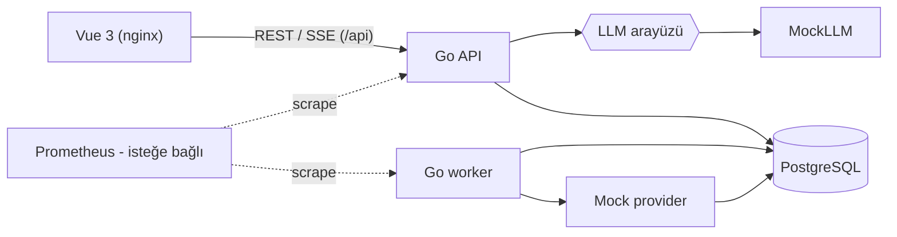

# Insider One Campaign Tool

[](https://github.com/oghuzkhandev/InsiderCampaignTool/actions/workflows/ci.yml)

Doğal dilde yazılan bir brief'ten hedef kitle, SMS ve e-posta taslağı
üreten bir kampanya aracı. Pazarlamacı taslağı inceler, gerekirse
düzenler ve onaylar. Gönderim işleri arka planda işlenir ve sonuçlar
canlı dashboard'da izlenir. Demo, sahte kullanıcılar (seed'de ~3 bin kişi)
ve **mock** SMS/e-posta sağlayıcısı kullanır; gerçek hiçbir kişiye mesaj gitmez.

## Hızlı başlangıç

Gereksinim: Docker ve Docker Compose. Başka bir şey kurmanız gerekmez.

```sh
docker compose up
```

Migration ve demo kullanıcı seed'i kurulum sırasında otomatik çalışır.
**İlk açılışta API, worker ve mock provider konteyner içinde derlenir ve Vue
uygulaması build edilir; birkaç dakika sürebilir.** `docker compose up --build -d --wait`
hepsi hazır olunca döner. Hazır olunca:

- Arayüz: <http://localhost:8080>
- API (doğrudan): <http://localhost:8081> (`/healthz`, `/readyz`)

### Demo akışı

1. <http://localhost:8080> adresini açın, **"Örnek brief'i kullan"** ile brief'i
   doldurun (veya kendiniz yazın) ve **"Kitleyi hesapla"** düğmesine basın.
   Segment doğrulanır; toplam, SMS'e ve e-postaya uygun kişi sayıları görünür.
2. **"İçeriği hazırla"** → **"İçerik üret"**: SMS metni, e-posta konusu ve gövdesi
   akarak gelir. Alanları düzenleyebilir ve **"Yeni sürüm olarak kaydet"** ile
   yeni sürüm oluşturabilirsiniz (`{{first_name}}` değişkeni desteklenir).
3. **"Onayla (sürüm N)"** → onay kutusu → **"Onayla ve kuyruğa al"**. Onaylanan
   sürüm ve gönderim işleri tek transaction'da kuyruğa yazılır; onaydan sonra içerik
   değiştirilemez.
4. **"Gönderimi izle"**: dashboard bekleyen, yeniden denenecek, gönderilen,
   başarısız ve atlanan mesajları canlı gösterir. Mock provider kasıtlı olarak
   zaman zaman 429 ve 500 üretir; yeniden denemeleri worker loglarında
   (`docker compose logs -f worker`) ve dashboard'daki "Yeniden denenecek" sayısında
   görebilirsiniz. Servis sağlığı ve metrikler için aşağıdaki
   [Gözlemlenebilirlik](#gözlemlenebilirlik) bölümüne bakın.

Her ekranda solda bir kenar çubuğu bulunur: **"Yeni kampanya"** ve **"Son kampanyalar"**
(en yeni 10; taslak kampanya içeriğe, onaylı kampanya gönderim takibine açılır). Üstteki
**"Campaign Tool"** başlığı ana sayfaya döner. Telefonda kenar çubuğu bir çekmecedir.

Mock provider'ın davranışı ortam değişkenleriyle değişir
([`.env.example`](.env.example)): gecikme, 429/500 oranı ve yanıt kaybı modları
(`accept_then_drop`, `drop_all_responses`).

## Gözlemlenebilirlik

Canlı durum dashboard'dadır (SSE). Servislerin sağlığı ve temel metrikleri ayrı uçlardan
okunur (TRK-001, ADR-016, ADR-027, ADR-028):

| Uç | Nerede | Ne verir |
| --- | --- | --- |
| `GET /healthz` | API, <http://localhost:8081/healthz> | Süreç çalışıyorsa `200`. Veritabanına bakmaz (veritabanı kesintisinde süreç yeniden başlatılmaz). |
| `GET /readyz` | API, <http://localhost:8081/readyz> | Veritabanına erişilebiliyorsa `200`, değilse `503` (gövde ayrıntı vermez). Compose sağlık kontrolü bunu kullanır. |
| `GET /metrics` | API ve worker, **yalnızca Docker iç ağında** (`api:9090`, `worker:9090`) | Prometheus metin biçimi. Host'a yayımlanmaz; API'nin ana portu `/metrics` sunmaz. |

İç ağdaki metrikleri host'tan okumak için:

```sh
docker compose exec web wget -qO- http://api:9090/metrics
docker compose exec web wget -qO- http://worker:9090/metrics
```

### Metrikler

| Metrik | Kimde | Anlamı |
| --- | --- | --- |
| `queue_depth{channel}` | API | Kanal başına `queued` mesaj sayısı (yeniden denenecekler dahil). Bellekte tutulmaz, her okunuşta veritabanından hesaplanır; böylece worker durduğunda da birikim görünür. Okunamazsa `/metrics` `503` döner (sessiz `0` yok). |
| `llm_validation_failures_total` | API | Doğrulamadan geçemeyen model çıktısı (segment ve içerik üretimi). Kullanıcının elle düzenlemesi sayılmaz. |
| `messages_sent_total` | worker | Provider'ın kabul ettiği ve `sent` yazılan mesaj sayısı. |
| `send_attempts_total{outcome}` | worker | Provider çağrılarının sonucu: `accepted`, `rate_limited` (429), `server_error` (5xx), `network_error`, `rejected` (429 dışı 4xx), `invalid_response`. |
| `ratelimit_wait_seconds` | worker | Bir denemenin provider çağrısından önce kanal hız sınırı yüzünden beklediği süre (histogram, 1 ms – 10 sn). |
| `stale_result_total` | worker | Eski sahiplik jetonu yüzünden yok sayılan sonuç sayısı. |
| `reaper_requeued_total` | worker | Lease'i dolduğu için yeniden kuyruğa alınan mesaj sayısı. |

Worker sayaçları süreç belleğindedir; worker yeniden başlarsa sıfırlanır. Mock provider metrik
sunmaz. Çıktı `promtool check metrics` ile doğrulanır (`make metrics-lint`, CI'da `E2E` işi).

**Loglar:** API ve worker yapılandırılmış (`slog`) log yazar; ayrı bir log toplama aracı
yoktur (ADR-028):

```sh
docker compose logs -f api worker
```

### İsteğe bağlı: Prometheus

```sh
docker compose --profile observability up -d
```

Prometheus arayüzü yalnızca <http://127.0.0.1:9091> adresinde açılır; API ve worker
`/metrics` uçlarını Docker iç ağından 10 sn aralıkla okur (bu uçlar host'a yayımlanmaz).
`up{job="api"}` ve `up{job="worker"}` hedeflerin erişilebilirliğini, `queue_depth` birikimi
gösterir. Veri 2 gün veya 256 MB ile sınırlıdır. Normal `docker compose up` Prometheus'u
başlatmaz. Grafana ve uyarı kuralı yoktur (aşağıdaki sınırlamalara bakın).

## Test

```sh
make test      # birim ve entegrasyon testleri (gerçek API anahtarı gerektirmez)
make e2e       # tarayıcı ve gerçek süreç uçtan uca testleri (izole Compose ortamı)
```

- `make test`: PostgreSQL'i Compose ile başlatır ve `campaigns_test` veritabanında
  `go test ./...` çalıştırır. Gereksinim: Docker ve Go 1.27 (`backend/go.mod`).
  Tüm LLM testleri MockLLM ile çalışır. Geliştirme veritabanına dokunulmaz.
- `make e2e`: üç döngü, her biri `campaign-e2e` adlı ayrı bir Compose projesinde
  (ayrı veritabanı ve portlar, geliştirme ortamına dokunmaz): standart tarayıcı
  testleri, gerçek worker + mock provider + SSE ile gönderim (`@real`) ve
  Prometheus doğrulaması (`promtool` dahil). Gereksinim: Docker, Node
  `^22.18 || >=24.12` ve bir kez `cd frontend && npx playwright install chromium`.
  Tek tek: `make e2e-standard`, `make e2e-delivery`, `make e2e-observability`.
- Frontend: `cd frontend && npm ci && npm run test:unit -- --run && npm run build`.

### CI

GitHub Actions (`.github/workflows/ci.yml`) her PR'da ve `main`'e push'ta çalışır:
backend (gofmt, vet, `go mod tidy`, `make test`), frontend (oxlint, eslint, birim
testleri, build), Compose yapılandırması ve E2E (standart, gönderim, observability).

## Mimari



Vue arayüzü aynı origin üzerinden nginx ile Go API'ye bağlanır; `/api` proxy'sinde
buffering kapalıdır, böylece içerik üretimi ve dashboard SSE akışları canlı kalır.
API, model çıktısını (segment ve içerik) backend'de doğrular; model çıktısı
hiçbir zaman SQL olarak çalıştırılmaz. Onay, onaylanan içerik sürümü ve `queued`
mesaj satırları tek PostgreSQL transaction'ında yazılır; kuyruk ayrı bir servis
değil PostgreSQL'dir (`FOR UPDATE SKIP LOCKED`). Go worker boş kapasitesi kadar işi
sahiplenir, kanal başına 100/sn hız sınırı uygular, kanal iznini gönderimden hemen
önce yeniden kontrol eder ve sonucu yalnızca güncel sahiplik jetonuyla yazar.
Mock provider `Idempotency-Key` ile mükerrer teslimi önler; kayıp yanıtta aynı
anahtarla yeniden denenir.

- [Case brief'i](docs/CASE.md)
- [Mimari](docs/ARCHITECTURE.md) ve [hata modları](docs/FAILURE-MODES.md)
- [Teknik kararlar (ADR)](DECISIONS.md)
- [İlerleme ve açık işler](docs/PROGRESS.md)
- [Repo yapısı](docs/REPO-STRUCTURE.md)
- [Claude çalışma oturumları](ai-sessions/README.md)

## Kapsam ve bilinen sınırlamalar

Çekirdek akış (brief → doğrulanmış segment ve kitle → içerik → insan onayı →
güvenilir gönderim → canlı izleme) uçtan uca çalışır ve testlidir. Yetiştirilemeyenler
ve bilinçli sınırlar:

- **Gerçek Claude adaptörü yok.** LLM arayüzü hazır (`llm.Provider`) ve tüm akış
  MockLLM ile çalışır ve test edilir; `LLM_PROVIDER` şimdilik yalnızca `mock` kabul
  eder. Anthropic API'ye bağlanan adaptör yazılmadı (API anahtarı yok; case gerçek
  modeli zorunlu tutmaz, mock ile geliştirmeye ve anahtarsız testlere izin verir).
  `ANTHROPIC_API_KEY` `.env.example` ve `compose.yaml` içinde tanımlıdır ama henüz
  hiçbir kod tarafından okunmaz. Model çıktısının doğrulanması, tek düzeltme denemesi
  ve akış yönetimi MockLLM'e karşı tamdır ve testlidir.
- **Tek worker süreci** (ADR-005). Eşzamanlı claim (`SKIP LOCKED`, sahiplik jetonu,
  lease) entegrasyon testlidir, ama birden çok worker *süreci* birlikte çalıştırılıp
  denenmedi; kanal başına hız sınırı da süreç başınadır.
- **Kimlik doğrulama ve yetkilendirme yok.** Herkes her kampanyayı görür; içerik
  üretimi (LLM maliyeti) için hız veya maliyet sınırı yok.
- **Bonus özellikler yok:** zamanlanmış gönderim, A/B varyantları, çok dilli içerik.
- **Mock provider istatistikleri bellektedir** (yeniden başlayınca sıfırlanır); kabul
  kayıtları PostgreSQL'dedir. Worker sayaçları da süreç belleğindedir.
- **Prometheus yalnızca isteğe bağlı bir demo/izleme aracıdır;** Grafana yok, uyarı
  kuralı yok. Metrik istemci kütüphanesi (`client_golang`) yerine küçük bir yazıcı
  kullanılır.
- **Veritabanı migration'ı** `00004`, riskli (daha önce denenmiş) mesaj varsa
  veriye dokunmadan durur; uygulama sırası [ADR-026](DECISIONS.md)'dadır.
- Arayüz koyu temada işletim sistemi ayarını izler; elle tema anahtarı yoktur.
- Arayüzde yalnızca MockLLM çıktısına göre ayarlanmış ekranlar test edildi;
  gerçek bir modelin üreteceği uzun veya bozuk çıktılar için doğrulama ve onarım
  mantığı birim testlidir, canlı model ile denenmemiştir.
