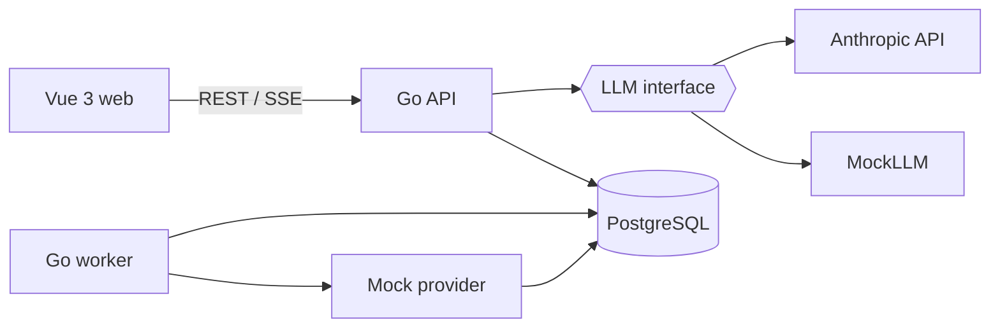
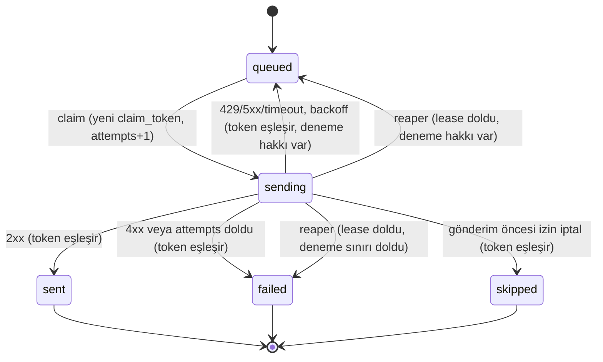

# Mimari

## 1. Genel bakış



| Bileşen | Sorumluluk |
| --- | --- |
| web | Brief girişi, kitle önizleme, içerik düzenleme, onay, canlı dashboard. Derlenmiş statik dosyalar nginx ile servis edilir; `/api` aynı origin'den API'ye proxy'lenir ve buffering kapalıdır (ADR-014). |
| api | REST/SSE, LLM çağrısı, doğrulama, onay, health, iç ağ `/metrics` endpoint'i ve `queue_depth` gauge'u |
| worker | Kuyruktan mesaj alma, hız sınırı, provider'a gönderme, retry, reaper, kampanya tamamlama, kendi `/metrics` endpoint'i |
| mock-provider | Sahte SMS/email servisi: gecikme, 500, 429, `accept_then_drop`, idempotency, istatistik |
| postgres | Kullanıcılar, kampanyalar, içerik sürümleri, mesajlar (kuyruk), LLM çağrı özeti, mock provider kabul kayıtları |
| migrate | Tek seferlik servis. Migration'ları `campaigns` database'ine uygular. |
| seed | Tek seferlik servis. Demo kullanıcı verisini yazar. Var olan kullanıcıya dokunmaz; tarihler yalnızca kullanıcı ilk oluşturulurken referans zamana göre yazılır. |

Tek Go modülü, `cmd/` altında birden fazla binary, tek Docker image. İlk
sürümde **tek worker süreci** çalışır (deployment varsayımı, bkz. ADR-005).

## 2. Akış

1. Brief → LLM segment DSL üretir → doğrulanır → parametreli SQL → toplam /
   SMS'e uygun / email'e uygun kişi sayıları.
2. İçerik üretimi SSE ile akar. Bitince tamamı doğrulanır ve bir **içerik
   sürümü** (`content_version`) kaydedilir.
3. İnsan önizler ve düzenler. Her düzenleme aynı doğrulayıcıdan geçer ve yeni
   bir sürüm olur.
4. Onay isteği `content_version` taşır (bölüm 6). Onay ile mesaj kayıtları
   **aynı transaction'da** yazılır.
5. Worker mesajları kanal başına hız sınırıyla provider'a yollar. Sonuç
   yalnızca claim token eşleşirse yazılır.
6. Bütün mesajlar terminal duruma ulaşınca kampanya `completed` olur.
7. Dashboard her saniye durum snapshot'ını SSE ile alır.

## 3. Durum makineleri

### Kampanya

`draft → approved → sending → completed`

- `approved`: Onay transaction'ı tamamlandı, mesajlar `queued`.
- `sending`: Worker ilk mesajı sahiplendi.
- `completed`: Hiç `queued` veya `sending` mesaj kalmadı.
- **Kampanya düzeyinde `failed` yoktur.** Onay transaction'ı başarısız olursa
  geri alınır ve kampanya `draft` kalır. 99 gönderildi + 1 başarısız ya da
  100'ü de başarısız olsa kampanya `completed` olur. Dashboard gerçek
  dağılımı gösterir.
- Sıfır uygun alıcılı kampanya onaylanamaz, bu yüzden boş bir `completed`
  oluşmaz.

### Mesaj



- Terminal durumlar `sent`, `failed` ve `skipped`.
- İzin kontrolü claim'den **sonra**, provider çağrısından **önce** yapılır.
  Kontrol limiter beklemesinden sonra yapılır. İzin kaydı yoksa veya izin
  iptal edilmişse `sending → skipped` olur ve provider'a istek gitmez.
- `attempts` işleme denemelerini sayar ve claim anında artar. Provider
  çağrısından önce çöken denemeler de bu sınıra dahildir. Gerçek provider
  çağrıları ayrıca ölçülür.
- Dashboard sayaçları `queued` (`attempts = 0`), `retrying` (`queued` ve
  `attempts > 0`), `sending`, `sent`, `failed`, `skipped`.

## 4. Veri modeli (özet)

Docker ile çalışan tek PostgreSQL instance'ında iki ayrı database bulunur.
API ve worker uygulama/demo verileri için `campaigns`, entegrasyon testleri
ise `campaigns_test` kullanır. Aynı migration'lar her ikisine de uygulanır;
her database aşağıdaki uygulama tablolarının kendi kopyasını içerir.
Testlerin veri oluşturma ve temizleme işlemleri yalnızca `campaigns_test`
üzerinde çalışır. Gerekçe: [ADR-012](../DECISIONS.md#adr-012--uygulama-ve-test-için-ayrı-postgresql-databaseleri).

- `users`: id, first_name, email, phone, city, language, last_cart_add_at,
  last_purchase_at, order_count
- `user_consents`: (user_id, channel) PK, granted
- `campaigns`: id, brief, segment (jsonb), status, approved_content_version,
  approved_at, completed_at, audience sayıları
  - İlk migration (`00001`) id (uuid), brief, segment, status, audience
    sayıları (toplam, SMS, e-posta) ve created_at alanlarını oluşturur. Onay
    alanları (`approved_content_version`, `approved_at`, `completed_at`)
    `00002` ile eklendi. `status` için `CHECK (draft, approved, sending,
    completed)` `00001`'den beri vardır.
  - Onay alanları durumla tutarlı olmalıdır (`CHECK`): `draft` iken boş,
    `approved`/`sending`/`completed` iken sürüm ve onay zamanı dolu,
    `completed_at` yalnızca `completed` iken dolu. `approved_content_version`
    aynı kampanyanın gerçek bir sürümüne bağlı bileşik yabancı anahtardır ve
    set edildikten sonra değiştirilemez (tetikleyici).
  - `segment` modelin ham metni değil, doğrulanmış yapıdır:
    `{"all":[{"field","op","value"}]}`. Veritabanı bu yapıyı `CHECK`
    constraint'i (`segment_is_valid`) ile zorlar: koşulsuz, 10'dan fazla
    koşullu, bilinmeyen alan veya operatörlü, yanlış tipli ve fazladan
    anahtar içeren segment kaydedilemez. Go ve veritabanı doğrulayıcıları ayrı
    kodlardır. Aynı kararı verdikleri yalnızca entegrasyon testindeki
    senaryolar için doğrulanmıştır; yeni alan veya operatör eklenince iki taraf
    ve test tablosu birlikte güncellenmelidir.
- `campaign_contents`: (campaign_id, version) PK, source (llm | human),
  sms_text, email_subject, email_body, created_at
  - Yalnızca **doğrulanmış** sürümler saklanır. Satırlar değişmez (immutable).
  - Doğrulaması başarısız bir üretim buraya yazılmaz (bkz. bölüm 9).
  - Sürüm numarası, kampanya satırı `FOR UPDATE` ile kilitliyken
    `max(version)+1` olarak yazılır (kesintisiz 1..N).
  - Veritabanı, Go doğrulayıcısının **tam aynası değil, temel koruma** sağlar:
    metin boşluktan ibaret değil, `{{first_name}}` dışında `{{`/`}}` yok,
    konuda satır sonu yok (`content_text_valid`). SMS 160 ve konu 80 kod
    noktası sınırı yalnızca Go'dadır (render sonrası uzunluk alıcı adına
    bağlıdır). Hangi girdilerde aynı kararı verdikleri entegrasyon testindeki
    senaryo tablosuyla sınırlıdır.
  - Tetikleyiciler uygulama kilidini ve durum kontrollerini yerinden etmez, ek
    koruma sağlar: satır güncellenemez, `draft` olmayan kampanyaya yeni sürüm
    eklenemez (kampanya satırında `FOR SHARE`, eşzamanlı onayı bekler),
    onaylanan sürüm değiştirilemez.
- `messages`: campaign_id, user_id, channel, recipient, status, attempts,
  next_attempt_at, **claim_token**, claimed_at (lease),
  idempotency_key (sabit: `campaign:user:channel`), last_error,
  failure_reason, sent_at
  - `UNIQUE (campaign_id, user_id, channel)`; `idempotency_key` biçimi
    `CHECK` ile zorlanır. `user_id` yabancı anahtarı silmeyi engeller,
    kampanya silinince mesajlar silinir. `failure_reason` değer listesi
    SND-001'de belirlenecek, şimdilik kısıtlı değil.
  - Gönderilecek metin mesaja kopyalanmaz. Worker,
    `campaigns.approved_content_version` üzerinden okur.
- `mock_provider_acceptances`: benzersiz `idempotency_key`, ilk kabul
  sonucu, kabul zamanı
- `llm_calls`: campaign_id, kind (segment | content), attempt, validation_ok,
  validation_error (kısa kod), latency_ms, token sayıları.
  **Ham yanıt saklanmaz.**

Önemli index'ler:

- `messages (channel, next_attempt_at) WHERE status='queued'` (claim)
- `messages (claimed_at) WHERE status='sending'` (reaper)
- `messages (campaign_id, status)` (dashboard ve tamamlanma kontrolü)

## 5. API

| Uç nokta | Not |
| --- | --- |
| `POST /api/campaigns` | Brief → segment + sayılar. Boş brief reddedilir. Geçersiz segmentte `422` `SEGMENT_INVALID` sebep kodlarıyla döner, kampanya oluşmaz. |
| `GET /api/campaigns/{id}` | Brief, segment, kayıtlı kitle sayıları, durum ve varsa son doğrulanmış içerik sürümü (`content` alanı, yoksa alan yok); bulunamazsa `404`. |
| `POST /api/campaigns/{id}/content` | İçerik üretimi, SSE (`delta`, `validated`, `error`) |
| `PUT /api/campaigns/{id}/content` | İnsan düzenlemesi doğrulanır ve yeni sürüm oluşturur (`200`). Onaydan sonra `409` döner. |
| `POST /api/campaigns/{id}/approve` | Gövde `{"content_version": N}` taşır. Onay, onaylanan sürüm ve `queued` mesajlar tek transaction'da yazılır (bölüm 6). |
| `GET /api/campaigns/{id}/events` | Dashboard SSE, her bağlantıda önce güncel snapshot |
| `GET /healthz`, `/readyz` | Liveness, DB ping |
| `GET /metrics` | Prometheus. Yalnızca Docker iç ağından erişilir, host'a açılan portta sunulmaz (ADR-016). |

Kampanya önizleme (`POST /api/campaigns`, `GET /api/campaigns/{id}`):

- `POST` gövdesi `{"brief": "..."}` olmalıdır (`Content-Type: application/json`,
  bilinmeyen alan ve fazladan JSON reddedilir). Başarıda `201` ve `Location`
  döner. Gövde: `id`, `brief` (kırpılmış), `status`, `segment` (doğrulanmış
  yapı), `audience` (`total`, `sms`, `email`) ve `created_at`. `GET` aynı
  gövdeyi `200` ile döner; içerik sürümü sonraki aşamada eklenir.
- Hata gövdesi: `{"error": {"code", "message", "reasons": [{"code", "field",
  "text"}]}}`. `reasons` yalnızca `SEGMENT_INVALID` için dolar. Model çıktısı
  ham olarak iletilmez; Türkçe açıklama arayüzde sebep koduna göre üretilir.
- Kodlar: `400 INVALID_REQUEST`, `413 REQUEST_TOO_LARGE`,
  `415 UNSUPPORTED_MEDIA_TYPE`, `422 BRIEF_EMPTY`, `422 BRIEF_TOO_LONG`,
  `422 SEGMENT_INVALID`, `503 LLM_RATE_LIMITED` (`Retry-After` ile),
  `504 LLM_TIMEOUT`, `404 CAMPAIGN_NOT_FOUND` (geçersiz uuid dahil),
  `404 NOT_FOUND`, `405 METHOD_NOT_ALLOWED` (`Allow` ile) ve `500 INTERNAL`.
- İstek gövdesi sınırı 64 KiB'dir (brief sınırı ayrıca 1000 karakter). Gövde
  okunurken sınır aşılırsa `413` döner; geçerli JSON'dan sonra gelen
  boşluklar sırasında aşılırsa da.
  İç hata ayrıntısı yalnızca loga yazılır, istemciye sızmaz.

İçerik uç noktaları (`POST` ve `PUT /api/campaigns/{id}/content`):

- **Ortak:** Kampanya yoksa (geçersiz uuid dahil) `404 CAMPAIGN_NOT_FOUND`;
  `draft` değilse `409 CAMPAIGN_NOT_DRAFT`. Bunlar akış başlamadan önce düz JSON
  hatadır. Başka yöntemler `405` (`Allow: POST, PUT`).
- **`POST`** gövde almaz; brief kampanyadan okunur. Yanıt SSE'dir
  (`Content-Type: text/event-stream`, `Cache-Control: no-store`,
  `X-Accel-Buffering: no`), akış başladıktan sonra HTTP durumu hep `200`'dür.
  Her olay `event:` ve tek satırlık JSON `data:` taşır ve hemen flush edilir:
  - `delta`: `{"field","text","replace"?}`. Geçici önizleme; `replace: true`
    alanın önceki önizlemesini siler (her değerin ilk parçasında gelir).
  - `validated`: `{"content_version","source","sms_text","email_subject",
    "email_body","created_at"}`. Yalnızca sürüm kaydedildikten (commit)
    sonra gelir. Arayüz önizlemeyi bu içerikle tümüyle değiştirir.
  - `error`: `{"code","message","reasons"?,"partial"?}`. Kodlar:
    `CONTENT_INVALID` (düzeltme de başarısız; `reasons` sebep kodlarıdır,
    `partial` çözümlenebilen **doğrulanmamış** metinlerdir ve yalnızca insan
    düzenlemesine başlangıç olarak sunulur), `LLM_TIMEOUT`, `LLM_RATE_LIMITED`,
    `STREAM_INTERRUPTED`, `CAMPAIGN_NOT_DRAFT` (üretim sırasında onaylandı),
    `CAMPAIGN_NOT_FOUND`, `INTERNAL`. Hata durumunda sürüm kaydedilmez.
  - **Akış yazılamazsa** (yazma veya flush hatası: istemci ayrıldı, bağlantı
    koptu) üretim hemen iptal edilir, sonraki olaylar yazılmaz ve hiçbir sürüm
    kaydedilmez; başlıklar bile yazılamıyorsa LLM hiç çağrılmaz. Bu bir
    uygulama hatası olarak loglanmaz. `validated` yazılamazsa (sürüm zaten
    commit edilmiştir) sürüm kalır ve istemci `GET` ile görür; yeniden
    yazma veya ikinci kayıt denenmez.
  - **Yavaş istemci:** Her yazmadan önce yazma süresi yenilenir (varsayılan
    10 sn, `Deps.SSEWriteTimeout`). Okumayan bir istemci toplam süreyi değil
    yalnızca tek bir yazmayı sınırlar; süre dolunca yazma hata verir ve yukarıdaki
    kural uygulanır.
  - LLM çağrısı sırasında veritabanı kilidi tutulmaz; kampanya satırı yalnızca
    kayıt transaction'ında `FOR UPDATE` ile kilitlenir.
- **`PUT`** gövdesi `{"sms_text","email_subject","email_body"}` (`application/json`).
  Aynı içerik doğrulayıcısından geçer. Başarıda `200` ve `validated` olayıyla
  aynı biçimde yeni sürüm (`source: "human"`). Geçersiz içerik
  `422 CONTENT_INVALID` ve sebep kodlarıyla döner, sürüm kaydedilmez. Ayrıca
  `400`, `413`, `415` önizleme uç noktalarıyla aynıdır.
- **Uzunluk doğrulaması:** `{{first_name}}` yerine, veritabanındaki en uzun gerçek
  adın (tüm kullanıcılar, kenar boşlukları atılmış kod nokta sayısı) ve
  fallback'in büyüğü konur. Kesin kontrol onayda her alıcı için yapılır.

Onay yanıtları (`POST /api/campaigns/{id}/approve`, gövde `{"content_version": N}`,
`application/json`; eksik, sıfır, negatif veya tam sayı olmayan sürüm `400`,
`413`/`415` önizleme uç noktalarıyla aynıdır):

- **`200`** — İlk onay ya da onaylanan aynı sürümle tekrar. Gövde: `id`,
  `status`, `approved_content_version`, `approved_at`, `queued`
  (`{sms, email, total}`: kuyruğa alınan mesaj sayıları). Tekrarda alıcılar
  yeniden hesaplanmaz: mevcut `approved_at` ve mesaj satırı sayıları döner, hiçbir iş
  eklenmez (kampanya `sending`/`completed` olsa da).
- **`404`** `CAMPAIGN_NOT_FOUND`.
- **`409`** — `NO_VALIDATED_CONTENT` (hiç doğrulanmış sürüm yok),
  `STALE_CONTENT_VERSION` (istenen sürüm son doğrulanmış sürüm değil),
  `CAMPAIGN_ALREADY_APPROVED` (kampanya başka bir sürümle onaylı). Hiçbir iş oluşmaz.
- **`422`** — `RENDER_LIMIT_EXCEEDED` (bir alıcı için kişiselleştirme sonrası
  SMS > 160 veya konu > 80; `reasons`: alan, etkilenen alıcı sayısı `count` ve
  örnek ad `text`), `NO_ELIGIBLE_RECIPIENTS` (hiçbir kanalda uygun alıcı yok),
  `UNFILTERED_SEGMENT`. Kampanya `draft` kalır, hiçbir iş oluşmaz.
- `GET /api/campaigns/{id}` onaylı kampanyada `approved_content_version` ve
  `approved_at` alanlarını da verir.

## 6. Onay transaction'ı

Kampanya satırı kilitlenir. Hem `PUT /content` hem de LLM çıktısının son
kaydı aynı kilidi alır ve `status = 'draft'` koşulunu kontrol eder.

Aşağıdaki blok onay akışının pseudocode'udur.

```text
BEGIN
Kampanyayı FOR UPDATE ile oku (status, approved_content_version).

Kampanya draft değilse:
  Kaydedilen onay sürümü istenen sürümle eşleşiyorsa mevcut sonucu 200 ile dön.
  Başka bir sürüm onaylanmışsa 409 dön.
  Yanıt dönmeden transaction'ı kapat. Bu dallarda alıcıları yeniden hesaplama.

Yalnızca draft kampanya için:
  İstenen sürüm son doğrulanmış sürüm değilse ROLLBACK ve 409.
  Doğrulanmış sürüm hiç yoksa da ROLLBACK ve 409.
  Segment filtresizse ROLLBACK ve 422.
  Kanal bazında uygun alıcı listesini bir kez seç.
  Liste boşsa ROLLBACK ve 422.
  SMS ve e-posta konusunu bu liste üzerinden render et ve doğrula.
  Limit aşılırsa ROLLBACK ve 422 (etkilenen alıcı sayısı ve örnek ad).
  Kampanyayı approved yap, onaylanan sürümü ve zamanı kaydet.
  Mesaj satırlarını aynı alıcı listesinden oluştur (ON CONFLICT DO NOTHING).
COMMIT
İlk onay sonucunu 200 ile dön.
```

Mesaj kayıtları oluşturulurken ikinci bir kitle sorgusu çalışmaz.
`ON CONFLICT DO NOTHING` yalnızca mesaj satırlarını tekilleştirir.
Yinelenen onay, kilit altında okunan onay sürümüne göre sonuçlanır.
Worker, provider çağrısından hemen önce kanal iznini tekrar kontrol eder.

Uygulama notları (`campaign.Approver`):

- Uygun alıcılar tek sorguyla (`segment.BuildRecipients`, kitle sayısıyla aynı
  koşullar) bir kez seçilir: segmente uyan ve en az bir kanalda açık izni olan
  kullanıcılar, kanal izinleriyle birlikte. Alıcılar **onay anında** seçilir;
  önizlemeden sonra izni geri çekilen kişi girmez, sonradan eşleşen izinli kişi
  girer. Bu yüzden kuyruk sayısı önizleme sayısından farklı olabilir; yanıt
  gerçek kuyruğu bildirir.
- Her alıcı için yalnızca kendi kanalının metni render edilir ve doğrulanır
  (SMS alıcısı için SMS, e-posta alıcısı için konu). Adı olmayan alıcıda
  fallback kullanılır.
- **Kanala uygunluk (ADR-023):** Kullanıcı bir kanala, o kanal için açıkça izin
  vermişse **ve** adresi (SMS için telefon, e-posta için e-posta) varsa
  uygundur. Kitle sayıları ve alıcı listesi aynı ifadeyi kullanır; önizleme ile
  kuyruk aynı kümeyi sayar (aradaki fark yalnızca önizleme ile onay arasındaki
  veri/zaman değişimidir).
- Mesaj satırları kanal başına tek `INSERT … SELECT unnest(…)` ile yazılır;
  `idempotency_key` = `kampanya:kullanıcı:kanal`.
- Onay yolunda LLM çağrısı yoktur; kampanya satırı kilidi yalnızca veritabanı
  işi sürerken tutulur.

## 7. Claim, sonuç yazımı ve kampanya tamamlama

Worker yalnızca boş gönderim kapasitesi kadar işi sahiplenir; büyük bir
sahiplenilmiş iş kuyruğu oluşturmaz. Limiter beklemesi lease süresine dahildir.
Provider çağrısından önce güncel claim token ve lease geçerliliği kontrol
edilir; geçerliliğini kaybetmiş iş için yeni çağrı başlatılmaz. Kanal izni
limiter beklemesinden sonra, çağrıya mümkün olduğunca yakın kontrol edilir.
Bu kontroller sırasında DB transaction'ı HTTP çağrısı boyunca açık tutulmaz.

Sorgular işleyişi gösteren örneklerdir.

```sql
-- Claim: kısa transaction. HTTP çağrısı bunun dışında yapılır.
UPDATE messages
SET status = 'sending',
    claim_token = gen_random_uuid(),
    claimed_at = now(),
    attempts = attempts + 1
WHERE id IN (
  SELECT id
  FROM messages
  WHERE channel = $1
    AND status = 'queued'
    AND next_attempt_at <= now()
    AND attempts < $3
  ORDER BY next_attempt_at
  LIMIT $2
  FOR UPDATE SKIP LOCKED
)
RETURNING id, claim_token, attempts, ...;

-- Sonuç: sent / failed / skipped / retry için aynı kalıp.
UPDATE messages
SET status = 'sent', sent_at = now()
WHERE id = $1 AND claim_token = $2 AND status = 'sending';
-- 0 satır: eski claim sonucu. Yok say, stale_result_total artırılır.

-- Kampanya tamamlama: her terminal yazımdan sonra ve reaper turunda.
UPDATE campaigns c
SET status = 'completed', completed_at = now()
WHERE c.id = $1
  AND c.status IN ('approved', 'sending')
  AND NOT EXISTS (
    SELECT 1
    FROM messages m
    WHERE m.campaign_id = c.id
      AND m.status IN ('queued', 'sending')
  );
```

| Mekanizma | Görevi |
| --- | --- |
| `claim_token` | Eski worker'ın geç gelen sonucunun yeni sahibin durumunu ezmesini önler. |
| Sabit `Idempotency-Key` + provider kabul kaydı | Yeniden denemenin ikinci teslimata yol açmasını önler. |
| `UNIQUE (campaign_id, user_id, channel)` | İkinci iş kaydının oluşmasını önler. |
| `attempts` | İşleme denemelerini sayar ve retry sınırını belirler. |

## 8. Zamanlamalar ve hız sınırı

| Ayar | Değer | Not |
| --- | --- | --- |
| Provider istek zaman aşımı | 10 sn | |
| Kapanış (SIGTERM) süresi | 15 sn | Docker `stop_grace_period` 20 sn. |
| Lease (claim geçerliliği) | 60 sn | Provider zaman aşımı ve kapanış bütçesinden uzun tutulur. |
| Reaper aralığı | 10 sn | Lease dolunca hakkı olan iş `queued`, hakkı biten iş hata sebebiyle `failed` olur. |
| Backoff | Taban 2 sn, katsayı 2, tavan 60 sn, tam jitter | `Retry-After` varsa ona uyulur. |
| Azami deneme | 5 | Varsayılan, ayarlanabilir. |
| Hız sınırı | Kanal başına ayrı limiter, hedef ~95/s, burst 1, **retry'lar dahil** | Her provider çağrısının önünde. |

`SIGTERM` geldiğinde yeni claim durur. Devam eden çağrılara 15 sn tanınır.
Süre dolarsa kalan satırları lease mekanizması geri alır.

Compose'ta `api` servisi için `stop_grace_period: 20s` tanımlıdır; Docker'ın
varsayılanı 10 sn olduğu için tanımlanmazsa süreç 15 sn dolmadan `SIGKILL` alır.
`go run` PID 1 olunca `SIGTERM`'i uygulamaya iletmediği için servis önce
derler, sonra ikiliyi `exec` ile çalıştırır. `worker` eklenince aynı iki ayar
onun için de uygulanır.

## 9. İçerik akışı ve yeniden bağlanma

- **JSON ve içerik akışı:** Model yalnızca `sms_text`, `email_subject` ve
  `email_body` alanlarını içeren yapılandırılmış JSON üretir. Backend JSON
  akışını birleştirir; çözümlenen alan metinlerini JSON verisi taşıyan `delta`
  SSE olaylarıyla iletir. `POST .../content` yanıtı `fetch` ile okunur;
  arayüz metinleri geçici önizleme olarak gösterir. Akış normal biterse
  backend tamamlanan JSON'u şema ve içerik kurallarıyla doğrular. LLM çağrısı
  sırasında DB kilidi tutulmaz. Sonuç hazır olduğunda
  kısa bir transaction'da kampanya satırı kilitlenir ve durum tekrar
  kontrol edilir. Kampanya hâlâ `draft` ise sürüm kaydedilir. Onaylanmışsa
  SSE ile `error` gönderilir. `validated` olayı yeni `content_version`
  ve kaydedilen içeriğin tamamıyla birlikte ancak commit sonrasında
  gönderilir. Arayüz önizlemeyi bu içerikle değiştirir.
- **Geçersiz JSON veya içerik:** Doğrulama hatalarıyla bir otomatik düzeltme
  denemesi yapılır. Bu sırada onay kapalıdır. Düzeltme JSON'u arka planda
  biriktirilir; doğrulanıp kaydedildiğinde `validated` ile önizlemenin
  tamamını değiştirir, eski metne eklenmez. Düzeltme de başarısızsa yeni
  sürüm kaydedilmez; çözümlenebilmiş alanlar hata mesajıyla düzenlemeye
  açılır. Hiç metin çözümlenemediyse yeniden üretme veya alanları doldurma
  sunulur. İnsan düzenlemesi JSON gövdesiyle `PUT` üzerinden aynı
  doğrulamadan geçer; onay yalnızca doğrulanmış sürümle mümkündür.
- **Akış kesintisi:** Yeni sürüm kaydedilmez, onay kapalı kalır ve arayüz
  hatayı gösterir. Otomatik düzeltme yapılmaz; yeniden üretme sunulur.
- **Taslağı geri yükleme:** Sayfa yenilendiğinde `GET /api/campaigns/{id}`
  ile kampanya ve son doğrulanmış içerik yüklenir. Kaydedilmemiş akış
  parçaları geri yüklenmez. Canlı takip dashboard SSE ile sürdürülür.
- **Dashboard akışı:** Bağlantı her yenilendiğinde sunucu önce güncel
  snapshot'ı yollar, sonra saniyelik güncellemeler gelir. Sayfa yenilenince
  durum veritabanından yeniden kurulur.

## 10. Doğrulama sınırı

| Nokta | Kontrol |
| --- | --- |
| Segment çıktısı | JSON şema → mantıksal alan → sabit eşleme tablosu → tip/aralık/derinlik → boş `unsupported` → parametreli SQL. Düzeltme yalnızca söz dizimi hatasında. |
| Filtresiz veya sıfır uygun alıcı | Onaya açılmaz. |
| İzin | Yalnızca açıkça izin verilmiş ve ilgili kanalın adresi (telefon/e-posta) olan alıcılar sayılır ve fan-out'a eklenir. Kayıt yoksa izin yoktur. Gönderimde limiter beklemesinden sonra tekrar kontrol edilir. |
| İçerik çıktısı | JSON şema → değişken whitelist → rune uzunluğu (en uzun gerçek ad ile) |
| Onay | Alıcı bazlı render doğrulaması ve sürüm kontrolü |
| İnsan düzenlemesi | Aynı içerik doğrulayıcısı |
| Brief | Güvenilmeyen girdi. Prompt uyarısına ek olarak backend doğrulaması uygulanır. |

## 11. Mock provider sözleşmesi

`POST /v1/sms` ve `POST /v1/email` isteklerinde `Idempotency-Key` zorunludur.
Yanıtlar `200` (`{message_id}`), `400` (geçersiz alıcı), `429`
(`Retry-After`) veya `500`. Hata modları ortam değişkenleriyle ayarlanır.

Provider ilk kabulü mevcut PostgreSQL içindeki `mock_provider_acceptances`
tablosuna **atomik** kaydeder. `idempotency_key` üzerinde benzersiz kısıt
vardır. Aynı anahtarla gelen istek kaydedilmiş ilk sonucu döndürür.
`accept_then_drop`, bir anahtar için yalnızca ilk kabul yanıtını, kayıt
commit edildikten sonra düşürür. Tekrar istekleri kayıtlı sonucu alır.
Provider yeniden başlasa da kabul kaydı korunur.

Bütün yanıtların kaybolması ayrı bir hata enjeksiyonuyla test edilir.
Deneme sınırında mesaj `failed`, `failure_reason = exhausted` olur.
Arayüz “Gönderim sonucu doğrulanamadı; deneme sınırı doldu” açıklamasını
gösterir. Bu sonuç provider'ın kesinlikle kabul etmediği anlamına gelmez;
aynı idempotency key ve kalıcı kabul kaydı tekrar teslimatı önler.

`GET /admin/stats` toplam istek ve benzersiz kabul sayılarını,
`duplicate_requests` (tekrar gelen ve ilk sonucu alan istekler),
`duplicate_deliveries` (aynı mesajın ikinci teslimi, beklenen `0`) ve kanal
bazında **her denemenin zaman damgasını** gösterir. Retry'lar kayan pencere
testine dahildir.

## 12. Gözlemlenebilirlik

Yapılandırılmış log `slog` ve request ID kullanır.

| Metrik | Tür | Üreten |
| --- | --- | --- |
| `messages_sent_total` | counter | worker |
| `send_attempts_total{outcome}` | counter | worker |
| `stale_result_total` | counter | worker |
| `reaper_requeued_total` | counter | worker |
| `ratelimit_wait_seconds` | uygulamada belirlenir | worker |
| `llm_validation_failures_total` | counter | api |
| `queue_depth{channel}` | gauge | api |

Counter'lar süreç belleğinde tutulur. API ve worker ayrı süreçlerdir; bu
yüzden worker kendi `/metrics` endpoint'ini sunar ve API worker
counter'larını göremez. `queue_depth` bellekte tutulmaz: API, `/metrics`
her okunduğunda `messages` tablosundan kanal başına `queued` mesaj sayısını
hesaplar. Böylece worker durduğunda da kuyruk birikimi görünür.

API ve worker `/metrics` endpoint'lerine yalnızca Docker iç ağından erişilir;
host'a yayımlanan portlardan sunulmaz. Gerekçe:
[ADR-016](../DECISIONS.md#adr-016--worker-kendi-metrics-endpointini-sunar).

`/healthz` API süreci çalıştığında `200` döner. `/readyz` DB erişimine
bağlıdır.

## 13. Test katmanları

- **Unit:** DSL, içerik, backoff, repair ve onay kuralları. Test ettiği
  paketin yanında durur (`backend/internal/...`).
- **Integration:** Gerçek PostgreSQL ile eşzamanlı claim, onay
  transaction'ı, claim token, reaper ve kampanya tamamlanması.
  `backend/tests/integration/` altındadır.
- **E2E (backend):** API, worker ve mock provider ile hata enjeksiyonu, kayan
  pencere hız testi, `accept_then_drop` sonrası provider restart ve aynı
  anahtarla retry, worker kill. `backend/tests/e2e/` altındadır.
- **E2E (frontend, Playwright):** Gerçek tarayıcıda, izole Compose ortamında
  (`compose.e2e.yaml`) ve kontrollü veriyle bir kullanıcı gibi: brief → kitle →
  içerik → düzenle → kaydet → onayla → yenile, geçersiz içerik, kaydedilmemiş
  düzenleme, eski sürümle onay. `frontend/e2e/` altındadır; `make e2e` ile koşar,
  `make test` içinde değildir (ADR-024).

Integration ve e2e dosyalarının adı testin çözdüğü konudur: bir veya en fazla
iki küçük harfli kelime (`idempotency_test.go`, `rate-limit_test.go`).

Entegrasyon ve E2E testleri ayrı test bağlantısı kullanır. Test hazırlığı,
`campaigns_test` database'inin oluşturulmasını ve aynı uygulama
migration'larının burada uygulanmasını kapsar. Veri hazırlama ve temizleme
yalnızca bu database'de yapılır. Her yazma aşamasından önce bağlantının
bildirdiği gerçek database adı tam olarak `campaigns_test` olmalıdır;
kontrol başarısızsa test durur. Uygulama bağlantısına geri dönüş yapılmaz.

Lease, reaper aralığı ve retry beklemeleri test yapılandırmasında
kısaltılabilir. Timeout ve lease ilişkileri korunur; uygulamanın varsayılan
süreleri değişmez. Test hazırlama adımları `make test` akışına dahil edilir.

`make test` yalnızca `postgres` servisini Compose ile ayağa kaldırır. E2E
testleri API, worker ve mock provider'ı Go testlerinden alt süreç olarak
başlatır; worker-kill testi gerçek `SIGKILL` kullanır. Entegrasyon testi
eklendiğinde test database'i PostgreSQL içinde hazırlanır ve ortak
migration'lar uygulanır. Gerekçe:
[ADR-015](../DECISIONS.md#adr-015--make-test-yalnızca-postgresi-ayağa-kaldırır).

## 14. Compose servisleri ve portlar

`docker compose up` yedi servis çalıştırır. `migrate`, `seed`, `api`,
`worker` ve `mock-provider` aynı backend imajını farklı komutlarla kullanır.
Gerekçe: [ADR-013](../DECISIONS.md#adr-013--yedi-compose-servisi-ve-başlatma-sırası).

| Servis | Rol | Host portu | Başlamak için beklediği |
| --- | --- | --- | --- |
| postgres | Veritabanı | `127.0.0.1:5432` | |
| migrate | Tek seferlik, migration | | postgres healthy |
| seed | Tek seferlik, idempotent demo verisi | | migrate tamamlandı |
| api | REST/SSE, LLM, doğrulama, onay | `127.0.0.1:8081` | seed tamamlandı |
| worker | Kuyruk işleyici, tek süreç | | seed tamamlandı |
| mock-provider | Sahte SMS/e-posta servisi | `127.0.0.1:8082` | seed tamamlandı |
| web | nginx, statik Vue ve `/api` proxy'si | `127.0.0.1:8080` | api |

- Portların hepsi yalnızca `127.0.0.1`'e açılır. Worker host'a port açmaz.
- API ve worker `/metrics` endpoint'lerine yalnızca Docker iç ağından
  erişilir; API'nin host'a açılan `8081` portundan sunulmaz (ADR-016).
- Başlatma sırası taslaktır, onay bekliyor.
- `web` içindeki `/api` proxy'sinde buffering kapalıdır; `delta` ve dashboard
  olayları bekletilmeden tarayıcıya ulaşır (ADR-014).
